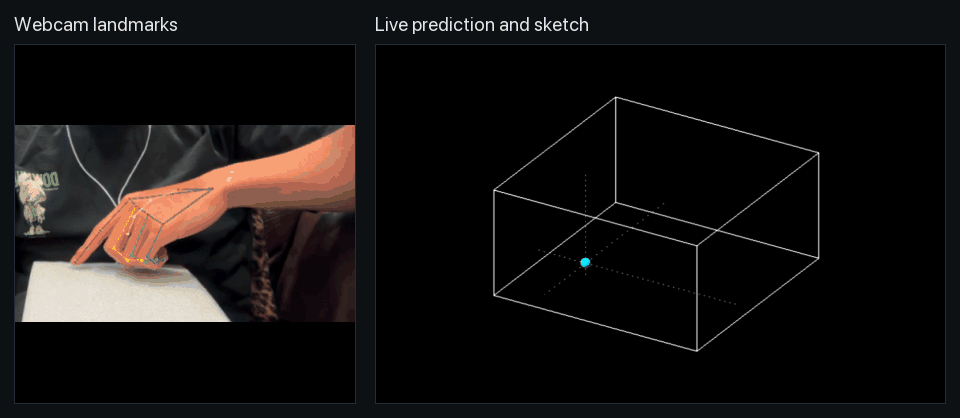
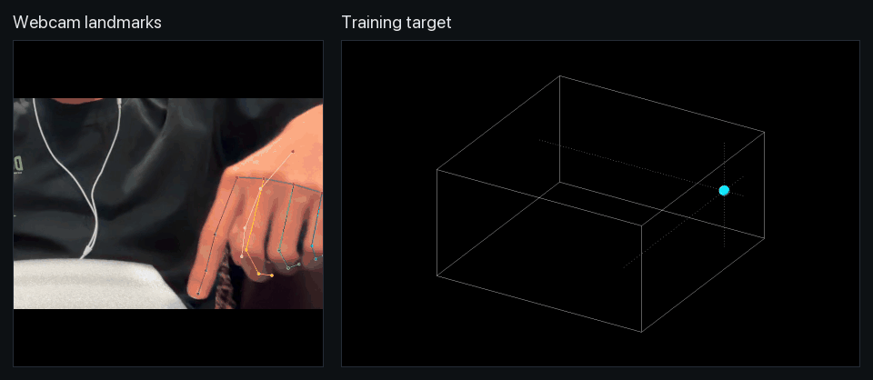

# 3D Hand Tracker

This started as a little experiment I made in a day. I wanted to see if I could use my webcam to draw in 3D with my index finger.

MediaPipe's open-source hand model gave me 21 landmarks and an estimate of each landmark's depth relative to my wrist. I still needed to figure out where my fingertip was inside a box I imagined in front of the camera. So I pointed at imaginary locations about 100 times, saved the landmarks each time, and trained a small PyTorch model to predict the position I was aiming for.

**Webcam → MediaPipe landmarks → lightweight PyTorch model → 3D position visualized in OpenGL**



*I place vertices with my fingertip, connect them into a sketch, then rotate the box to see the shape from different angles.*

## Collecting training data



*I aim my fingertip at the teal target and press Space. The collector saves the current landmarks with that target's coordinates, then shows the next target.*

## Run it

You'll need Conda, a webcam, and a desktop with OpenGL support. I ran the project on an Apple Silicon Mac. The first camera run downloads MediaPipe's pretrained Hand Landmarker.

```sh
git clone https://github.com/d-kwong/3D-Hand-Tracker.git
cd 3D-Hand-Tracker
conda env create -f environment.yml
conda activate hand-tracker

python collect_data.py   # Collect samples with Space, then exit with Esc
python train.py          # Train on the newest capture
python predict_live.py   # Watch the fingertip prediction
# Or open the same live view with drawing controls
python draw_live.py
```

Captures are timestamped `.jsonl` files in `data/`. Training saves a `.pt` checkpoint alongside the capture. Both live scripts load the most recently saved checkpoint by default. Pass a path to choose a specific capture or checkpoint.

```sh
python train.py data/capture_...jsonl
python draw_live.py data/capture_...pt
```

| Control | Action |
| --- | --- |
| **Space** | Capture a sample in collection mode |
| **1** | Place a vertex at the predicted fingertip |
| **2** | Place a vertex and connect it to the previous one |
| **C** | Clear the sketch |
| **Left-drag** | Pan in the drawing window |
| **Right-drag** | Rotate around the center of the box |
| **Esc** | Close the session |

## How it works

OpenCV reads the webcam frames and MediaPipe returns 21 landmark triples. I flatten those into 63 inputs, pass them through a 32-unit ReLU layer, and predict three coordinates in the virtual box. The box is centered at the origin with a 2:2:1 ratio across X, Y, and Z. The dotted lines show where the estimated position projects onto its faces.

The labels are the targets I aimed for, so they include my own aiming error. The coordinates are in arbitrary box units. The demos show how the prototype responds to movement, while measuring accuracy would require known physical reference points.
